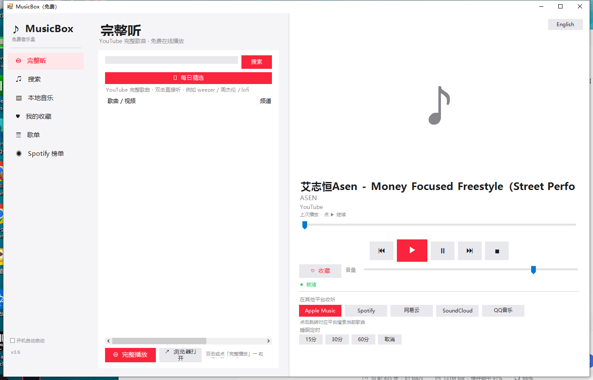
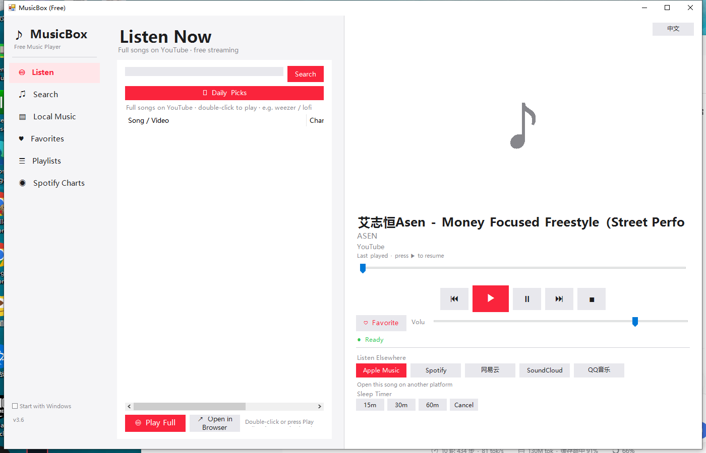

# MusicBox（免费）· MusicBox (Free)

一个 **Windows 10 / 11（64 位）** 桌面音乐播放器：**Apple Music 风格界面** · **中英双语** · **响应式布局** · 全网搜索试听 + 本地音乐播放。

> A **Windows 10 / 11 (64-bit)** desktop music player with an Apple Music–style UI, bilingual (中文 / English) interface, responsive layout, online 30-second previews and local music playback.





---

## ✨ 功能 · Features

| 中文 | English |
|---|---|
| 🎨 Apple Music 风格界面（浅灰底 + 纯白卡片 + 品牌红 `#FA243C`） | Apple Music–style UI (light gray, white cards, brand red `#FA243C`) |
| 🌏 右上角一键切换 **中文 / English**，选择会被记住 | One-click **中文 / English** toggle in the top-right, remembered across restarts |
| 📐 响应式布局：窗口任意缩放自适应，小窗自动精简，`F11` 全屏 | Responsive layout: any window size, auto-compact on small windows, `F11` fullscreen |
| 🔍 全网搜索试听（Deezer 官方 30 秒片段），支持搜索历史 | Global search with official Deezer 30-second previews + search history |
| 📺 YouTube 完整播放，内置播放器 16:9 大画面（按面板宽度铺满） | Full playback via YouTube in a built-in 16:9 player that fills the panel |
| 🎵 Spotify 官方榜单，内置浏览器直接浏览各流派歌单 | Spotify official charts browsed in an embedded browser |
| 💻 本地音乐播放（MP3 / FLAC / WAV / M4A / WMA），支持拖拽导入 | Local playback (MP3 / FLAC / WAV / M4A / WMA) with drag & drop |
| ♥ 收藏夹 · ☰ 自建歌单 · 播放历史 | Favorites · custom playlists · play history |
| ⏱ 睡眠定时（15/30/60 分钟）、播完自动下一首、记住上次播放 | Sleep timer (15/30/60 min), auto-next, resume last played |
| ⌨️ 键盘快捷键 | Keyboard shortcuts |

### ⌨️ 快捷键 · Shortcuts

| 按键 · Key | 功能 · Action |
|---|---|
| `空格` / `Space` | 播放 / 暂停 · Play / Pause |
| `←` `→` | 快退 / 快进 5 秒 · Seek ∓5s |
| `↑` `↓` | 音量 · Volume |
| `Ctrl+S` | 搜索页 · Search page |
| `Ctrl+L` | 本地音乐 · Local music |
| `Ctrl+F` | 收藏当前歌曲 · Favorite current song |
| `Ctrl+D` | 每日精选 · Daily picks |
| `F11` / `Esc` | 全屏 / 退出全屏 · Fullscreen / Exit |

---

## 🚀 使用方法 · Getting Started

### 方式一：直接运行（推荐）
1. 下载 `dist/MusicBox.exe`（或 `dist/MusicBox-Share.zip` 解压后运行）
2. 双击 `MusicBox.exe` 即可，**无需安装、无需管理员权限**

> 若把 `MusicBox.exe` 与 `Microsoft.Web.WebView2.*.dll`、`WebView2Loader.dll` 放在同一目录，内置播放器功能完整；
> 缺少这些 DLL 时应用仍可正常使用，只是视频/榜单会改为在系统浏览器中打开。

### 方式二：从源码运行
```powershell
# 需要 Windows PowerShell 5.1（系统自带）
powershell -ExecutionPolicy Bypass -STA -File src\MusicBox.ps1
```

### 方式三：自行编译 exe
```powershell
# 安装编译模块（一次性）
Install-Module ps2exe -Scope CurrentUser

# 编译
powershell -ExecutionPolicy Bypass -File tools\build.ps1
```

---

## 💻 系统要求 · Requirements

- Windows 10 / 11（64 位）
- **Windows PowerShell 5.1**（系统自带，用于源码运行）
- **WebView2 Runtime**（Win11 自带；Win10 通常随 Edge 安装。缺失时自动降级）
- **Windows Media Player 组件**（用于音频播放；Windows N 版需在「设置 → 应用 → 可选功能」中安装「媒体功能包」）

> 程序是**便携式**的：所有数据（收藏、歌单、历史、封面缓存）都保存在 **exe 所在目录** 的 `userdata/` 与 `cover_cache/` 下，不写注册表、不写系统目录（开机自启除外，该功能由你手动勾选）。

---

## 📁 目录结构 · Project Layout

```
musicbox-free/
├── src/
│   └── MusicBox.ps1          # 全部源码（单文件 PowerShell + WinForms）
├── dist/
│   ├── MusicBox.exe          # 已编译的可执行文件
│   ├── MusicBox-Share.zip    # 分享包（含 WebView2 DLL，解压即用）
│   ├── Microsoft.Web.WebView2.Core.dll
│   ├── Microsoft.Web.WebView2.WinForms.dll
│   └── WebView2Loader.dll
├── docs/
│   ├── screenshot-zh.png
│   └── screenshot-en.png
├── tools/
│   └── build.ps1             # 一键编译脚本
├── CHANGELOG.md
├── LICENSE
└── README.md
```

---

## 🇬🇧 English

A lightweight, portable Windows music player with an Apple Music–style interface.

**Highlights**
- **Bilingual UI** — switch between 中文 and English from the top-right button; the choice is saved.
- **Responsive** — the whole layout re-flows on resize; heavy panels collapse on small windows; `F11` for borderless fullscreen.
- **Apple Music look** — `#F5F5F7` background, white cards, `#FA243C` accent, hairline separators, large album art.
- **Search & preview** — official Deezer 30-second previews with search history.
- **Full songs** — YouTube playback in a built-in 16:9 player sized to the panel width, with a compact control strip (title / progress / transport).
- **Spotify charts** — official playlist embeds, no sign-in required.
- **Local library** — MP3 / FLAC / WAV / M4A / WMA, drag & drop supported.
- **Library management** — favorites, custom playlists, play history, sleep timer, auto-next, resume last played.

**Run it**: download `dist/MusicBox.exe` and double-click — no install, no admin rights.
**Build it**: `powershell -ExecutionPolicy Bypass -File tools\build.ps1` (requires the `ps2exe` module).

Everything is stored next to the executable (`userdata/`, `cover_cache/`) — nothing is written to the registry or system folders.

---

## ⚠️ 免责声明 · Disclaimer

- 本项目为**个人学习与技术演示**用途，与 YouTube、Spotify、Deezer、Apple 均**无关联**，也未被其授权或认可。
- 应用**不下载、不存储、不重新分发**任何受版权保护的音频或视频内容；搜索与试听数据来自第三方公开接口，视频播放使用其官方内嵌播放器。
- 请遵守你所在地区的法律法规及第三方平台的服务条款；**请勿用于商业用途**。
- 使用本软件产生的任何后果由使用者自行承担。

> This project is for **personal learning and technical demonstration only**. It is **not affiliated with, authorized, or endorsed by** YouTube, Spotify, Deezer or Apple. It does **not** download, store, or redistribute any copyrighted media. Please comply with your local laws and the terms of service of third-party platforms. **Not for commercial use.** Use at your own risk.

---

## 📄 License

代码以 [MIT License](LICENSE) 开源。
The source code is released under the [MIT License](LICENSE).
